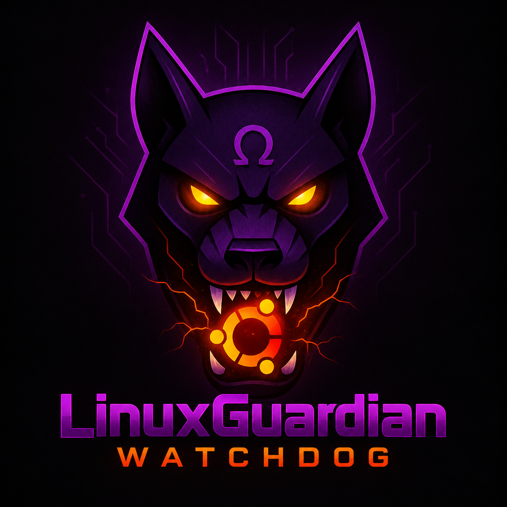

<p align="center"></p>

# LinuxGuardian Watchdog

A free, integrated security platform for Linux desktops — a native port of
[MacGuardianWatchdog](https://github.com/abelxmendoza/MacGuardianWatchdog),
rebuilt for the Linux desktop instead of macOS.

Same idea as the original: real security tools (not just a UI) in one place —
antivirus scanning, rootkit detection, file integrity monitoring, a process
killer, a cache cleaner, one-click software updates, security posture auditing, and automated
remediation — orchestrated by a native desktop app, with all data kept local
to the machine. The GUI also carries over the original's dark "Omega
Black-Ops" theme (purple/red/yellow accents on near-black).

> **Status: Phase 1.0 stabilization complete: ready for limited daily use by its owner (class B), not a distribution.** It is run from a
> checkout of this repository on Ubuntu 22.04 (GNOME on X11), not installed from a package. It reduces risk and makes problems visible;
> it does **not** guarantee protection against malware or attacks. What was tested, what was not, and what is still open is written down in
> [docs/RELEASE_READINESS.md](docs/RELEASE_READINESS.md) and [docs/TESTING.md](docs/TESTING.md); plans are in [docs/ROADMAP.md](docs/ROADMAP.md).

## What it does

**Principle:** it watches and explains; you decide. Nothing is deleted, killed, blocked or changed automatically. Actions that change the
machine are previewed first, ask for your confirmation, are undoable where possible, and the few that need administrator rights go through
a fixed script and one polkit password prompt. Security should protect you, not fight you: routine changes (such as editing your own code
in a development checkout, or running ROS 2 / PX4 / Gazebo / Docker) are recorded quietly rather than raised as alarms.

| Area | What you get |
|---|---|
| **Dashboard** | One-button scans (ClamAV + rkhunter), a scored posture audit (firewall, SSH, updates, sudoers, disk...), scanner health (definitions age, rootkit baseline), live activity. |
| **Live monitoring** (systemd user timer, every 5 min) | 13 read-only sensors: logins, processes, network (with free known-bad address lists), start-up entries, accounts, USB, dropped programs, LinuxGuardian's own files, tripwires on SSH keys and sudo/login/package-source rules, decoy files, defenses switched off, new setuid programs, and slow logins (a black screen before the desktop, tied to any change LinuxGuardian made before it). A dead-man's switch warns if monitoring itself stops. |
| **Incidents** | Related events grouped into plain-language stories with next steps, a **Timeline** (repeats folded, mark as seen), one-click read-only evidence bundles, and an honest **attack coverage map** (what is covered, partly covered, not covered). Optional, opt-in AI explainer (local Ollama or Claude): redacted, advisory only, read-only checks. |
| **Alert policy** | Every event is an *incident* (something may have happened), a *finding* (a standing weakness) or *information*. Desktop pop-ups only for warning-and-above incidents and critical findings. A risk you accept stays visible but stops nagging; it never hides an unrelated incident. |
| **Malware** | Findings explained in plain language, re-verification, **reversible quarantine**, restore, permanent delete only on request; a guide to the kinds of Linux malware. |
| **Hardening** | A checklist of weak settings with previewed, undoable fixes. |
| **VPN** | Tailscale + Proton VPN status, leak and conflict diagnostics. |
| **Processes** | List, filter, explain, end or force-kill with confirmation (safe-guarded: critical names refused, no mass kills). |
| **Cleaner** | Browser and system caches, dry-run first. |
| **Updates** | Pending security/system/third-party/snap updates, one-click install via polkit, release guard, pinned stacks (ROS 2, Gazebo, NVIDIA) never forced. |
| **Exposure** | What is listening and who can reach it; a ROS 2-aware firewall helper that adds narrow `ufw` rules for one robot, previewed and removable. |
| **Firewall** | The ufw firewall at a glance (on/off, defaults, logging, whether its service actually started, and why not), the numbered rules, what was blocked recently and from where. Controls: turn on/off, restart, defaults, logging, add a rule (previewed, warns when it opens a port to anyone), delete a rule (only if it is still the rule you saw). One password prompt per change. |
| **Apps** | Export your app list and plan/install it on another Ubuntu laptop (no repos, keys or dotfiles). |
| **File integrity** | SHA-256 baseline of documents and persistence locations (shell files, `~/.ssh`, autostart, git hooks); development checkouts are treated sensibly. |
| **Self-care** | Title-bar **Terminal** button (every feature as a copyable command if the app breaks), **Health** button (the app checking its own files, permissions and state), per-tab crash safety and a crash log. |

## Status of verification (summary)

1398 automated tests pass (unit, integration, end-to-end through the real window, fuzzing, failure and packaging tests), plus 8 shell
suites; ruff, bandit, shellcheck and pip-audit are clean; line coverage is 79 %. Root-level tools (`apt`, `ufw`, `freshclam`, `rkhunter`,
`pkexec`) are tested against stand-ins only; the GitHub Actions workflows have not yet run on GitHub; ROS 2 / PX4 / Gazebo workloads and
real-attack detection are untested. Details and numbers: [docs/RELEASE_READINESS.md](docs/RELEASE_READINESS.md).

## Architecture

Same hybrid split as the macOS original: a native GUI frontend that shells
out to security scripts which do the real work, so the heavy lifting stays
inspectable, scriptable, and usable from a terminal even without the GUI.

| Layer | macOS original | Linux port |
|---|---|---|
| GUI toolkit | SwiftUI (native macOS) | GTK4 + libadwaita (native GNOME/Linux desktop), Python |
| Scan engine | ClamAV + rkhunter | ClamAV + rkhunter (same tools, native on Linux) |
| Scheduling | `launchd` | `systemd` user timers |
| Service management | `launchctl` | `systemctl --user` |
| File integrity | SHA-256 baseline (bash) | SHA-256 baseline (bash, ported as-is — fully portable) |
| Local data dir | `~/.macguardian/` | `~/.linuxguardian/` |
| Firewall checks | macOS Application Firewall | `ufw` / `firewalld` (auto-detected) |
| Behavioral / ML layer | Python (`ai_engine.py`, `ml_engine.py`) | Python, ported later (see roadmap) |

## Repository layout

```
LinuxGuardianWatchdog/
├── images/                   # Logo (full) and app icon
├── LinuxGuardianSuite/       # Shell + Python scripts that do the actual work
│   ├── config.sh             # Shared paths, colors, defaults
│   ├── utils.sh              # Shared logging/helper functions
│   ├── linux_guardian.sh     # ClamAV + rkhunter scan orchestration
│   ├── linux_watchdog.sh     # SHA-256 file integrity baseline + honeypot
│   ├── linux_security_audit.sh  # Scored security posture checks
│   ├── linux_process_manager.sh # Process killer: list, SIGTERM/SIGKILL by PID or name
│   ├── linux_cache_cleanup.sh   # Cache cleaner: browser + system caches, dry-run by default
│   ├── linux_updates.sh         # Updates: check + install apt/snap updates (password via polkit)
│   ├── update_inventory.py      # Read-only inventory of pending updates (security/system/third-party/snap)
│   ├── linux_exposure.sh        # Network exposure: what's listening and who can reach it (detection only)
│   ├── exposure_inventory.py    # The detector behind it (ss + interfaces + firewall state, no root)
│   ├── scanner_health.py        # Read-only: definitions age, updater state, rootkit baseline
│   ├── integrity.py             # File integrity engine behind linux_watchdog.sh
│   ├── timeline.py              # Folds repeated findings into a timeline
│   ├── notify_events.py         # Desktop notifications for new warnings
│   ├── rkhunter_baseline.py     # Checks warned files against their packages before a baseline refresh
│   ├── app_manifest.py          # Export/plan app lists for moving to another laptop
│   ├── sensors.py               # Blue-team sensors (logins, processes, network, startup entries, accounts, USB)
│   ├── ai_investigator.py       # Opt-in AI that explains incidents (redacted, validated, advisory only)
│   ├── ai_safety.py             # Redaction + the read-only command allow-list around the AI
│   ├── ai_eval.py               # Quality check: grades a local AI model on made-up attacks and tricks
│   ├── local_ai.py              # Free local AI setup: hardware fit, Ollama steps, model download
│   ├── threat_intel.py          # Known-bad address lists (free, no account) checked against connections
│   ├── fallback.py              # Every feature as a copyable/openable terminal command (with and without the app)
│   ├── self_check.py            # The app checking itself: file hashes vs git, permissions, damaged state, upkeep
│   ├── tripwires.py             # SSH keys, sudo/login rules, software sources, package registries: change = alert
│   ├── defenses.py              # Firewall / virus updater / AppArmor switched off after being on
│   ├── setuid_watch.py          # New or changed setuid/setgid programs (way back to administrator rights)
│   ├── decoys.py                # Fake SSH key / cloud credentials / .env that raise an alert if opened
│   ├── attack_coverage.py       # Honest map: which common attacks are covered, partly covered, or not
│   ├── malware_guide.py         # Explainer: kinds of Linux malware, how to recognise them
│   ├── quarantine.py            # Malware cleaner: re-verify, quarantine reversibly, restore, delete on request
│   ├── incidents.py             # Groups sensor events into explained incidents
│   ├── evidence.py              # Read-only evidence bundle for an incident
│   ├── hardening.py             # Hardening checklist with previewed, undoable fixes
│   ├── linux_hardening.sh       # The hardening fixes that need root (fixed scripts)
│   ├── vpn_status.py            # Tailscale + Proton VPN status and leak/conflict diagnostics
│   ├── diagnostics.py           # Feature-by-feature self-check
│   ├── ros_firewall.py          # ROS 2 domain port math + peer validation for the firewall helper
│   ├── linux_ros_firewall.sh    # Preview/add/remove narrow ufw rules for a robot
│   ├── firewall_control.py      # ufw status in plain words, rule parsing, rule plans, block-log summary (no root)
│   ├── linux_firewall.sh        # Firewall tab backend: status, rules, add/delete, on/off, defaults, logging
│   ├── login_watch.py           # Times each login; ledger of system changes LinuxGuardian made, with undo commands
│   ├── linux_apps.sh            # ...and the installer for them
│   ├── events.py                # Shared security-event format written to ~/.linuxguardian/incidents/
│   ├── audit_events.py          # Risk acceptance + audit findings as events
│   ├── process_inventory.py     # Explains what each running process is (read-only)
│   ├── scan_store.py            # Saved scan results
│   ├── install_scheduler.sh  # Installs systemd user timers for automation
│   └── modules.conf.example
├── LinuxGuardianSuiteUI/     # Native GTK4 / libadwaita desktop app (Python)
│   ├── linuxguardian_ui/     # window, pages (tabs), helpers
│   └── tests/                # pytest suite (unit, integration, end-to-end, security, packaging)
├── docs/                     # ARCHITECTURE, ROADMAP, TESTING, RELEASE_READINESS
├── tests/                    # Shell suites for the privileged scripts (run against stub pkexec/apt/ufw)
├── .github/                  # CI (tests only; no deploy), CodeQL, Dependabot
├── ruff.toml, .bandit        # Static-analysis configuration
└── requirements-dev.txt      # Pinned test/lint tools (not needed to run the app)
```

## Requirements

Target: Ubuntu 22.04 with GNOME on X11 (libadwaita 1.1). Other distributions are untested.

```bash
sudo apt install python3 python3-gi gir1.2-gtk-4.0 gir1.2-adw-1 \
                 clamav rkhunter policykit-1 libnotify-bin iproute2 ufw util-linux
```

| Needed for | Packages / programs | If it is missing |
|---|---|---|
| The window | `python3-gi`, `gir1.2-gtk-4.0`, `gir1.2-adw-1` (libadwaita) | the GUI doesn't start; every script still works from a terminal |
| Malware and rootkit scans | `clamav` (`clamscan`, `freshclam`), `rkhunter` | scans say the scanner is missing instead of reporting "clean" |
| Password prompts for the few root actions | `policykit-1` (`pkexec`) with a desktop auth agent | root actions are refused with a clear message; nothing runs unprivileged instead |
| Scheduled scans and live monitoring | `systemd` user session (`systemctl --user`) | timers can't be installed; run the scripts by hand |
| Desktop notifications | `libnotify-bin` (`notify-send`) | notifications are skipped; events are still recorded |
| Network and disk checks | `iproute2` (`ss`, `ip`), `util-linux` (`lsblk`), `ufw` | those checks report "unknown", never "all clear" |
| Optional | `tailscale`, Proton VPN (via NetworkManager), `ollama` (local AI), the `anthropic` Python SDK (cloud AI) | the matching feature shows as unavailable |

The Python code itself uses only the standard library plus PyGObject: no `pip install` is needed to run it. Tools for developing and
testing it are pinned in `requirements-dev.txt`.

## Getting started: the scripts (no GUI needed)

Every feature also works from a terminal.

```bash
cd LinuxGuardianSuite
./linux_watchdog.sh --init                 # create the file-integrity baseline
./linux_guardian.sh --scan                 # run a ClamAV + rkhunter scan
./linux_security_audit.sh                  # scored security posture check
./linux_process_manager.sh --list          # process killer: list processes
./linux_process_manager.sh --kill PID      # ...or --kill-name NAME [--force]
./linux_cache_cleanup.sh --scan            # cache cleaner: preview reclaimable space
./linux_cache_cleanup.sh --clean --apply   # ...actually clear it
./linux_updates.sh --check                 # updates: what's pending (no root needed)
./linux_updates.sh --apply --dry-run       # ...preview an install; changes nothing
./linux_updates.sh --apply                 # ...install all (password prompt via polkit)
./linux_updates.sh --apply --security-only # ...or just the security fixes
./linux_updates.sh --hold ros2             # freeze a stack (ros2 | gazebo | nvidia) so nothing updates it
./linux_updates.sh --unhold ros2           # ...and let it update again
./linux_guardian.sh --health               # can you trust a scan right now? (definitions age, rootkit baseline)
./linux_guardian.sh --update               # update virus definitions (password via polkit)
./linux_apps.sh --export apps.json         # list this laptop's apps (no files, passwords or keys)
./linux_apps.sh --plan apps.json           # on another laptop: preview what installing the list would do
./linux_apps.sh --install apps.json        # ...install the Ubuntu apps and snaps that are available (password via polkit)
./linux_watchdog.sh --init                 # file integrity: Documents + start-up locations (ssh, autostart, shell files)
./timeline.py --min-severity warning       # the security timeline from the terminal
./sensors.py --run                         # blue team: look for attacks in progress (the timer runs this every 5 minutes)
./ai_investigator.py --status               # optional AI investigator (off by default; local Ollama or Claude)
./local_ai.py --status                     # free local AI: what your laptop can run, and the next setup step
./ai_eval.py --run --model qwen2.5:7b      # grade a local model on 17 made-up incidents (Good / Use with caution / Not reliable)
./threat_intel.py --update                 # download the free known-bad address lists (and turn the check on)
./self_check.py --check                    # is LinuxGuardian itself intact, private and still watching?
./quarantine.py --findings                 # what the last scan flagged (--quarantine PATH, --restore ID, --delete ID)
./tripwires.py --check                     # did an SSH key, sudo rule, login rule or package registry just change?
./audit_events.py --accept "No LUKS-encrypted volume detected"   # a risk you chose to live with: stays visible, stops nagging (--unaccept, --accepted)
./defenses.py --check                      # is the firewall (and the other protections) on, and was anything switched off?
./setuid_watch.py --check                  # new or changed setuid programs (also run every six hours by the live monitor)
./self_check.py --heartbeat                # dead-man's switch: warn if live monitoring was switched off (the daily scan runs this)
./decoys.py --create                       # plant fake secrets that alert if anything opens them (--status, --remove)
./attack_coverage.py --gaps                # what the sensors can and can't notice, and what to build next
./fallback.py --list                       # every feature as a plain terminal command (--open ID opens it in a terminal)
./incidents.py                             # related events grouped into plain-language incidents
./evidence.py --incident ID                # read-only evidence bundle for an incident
./hardening.py --check                     # hardening checklist: what's weak, why, and the fix (no root)
./linux_hardening.sh --apply sysctl        # the fixes that need a password (sysctl | ufw_ipv6 | ufw_logging); --undo reverses
./vpn_status.py                            # Tailscale + Proton VPN: connected? leaking? fighting each other?
./diagnostics.py                           # which features work, and what is missing for the ones that don't
./linux_ros_firewall.sh --plan --peer 192.168.1.50 --preset mavlink   # ROS 2 + ufw: preview narrow rules for ONE robot
./linux_ros_firewall.sh --apply --peer 192.168.1.50                      # ...add them (one password prompt); --remove undoes them
./linux_guardian.sh --enable-auto-update   # turn on ClamAV's background updater (asks first, password via polkit)
./linux_guardian.sh --scan --rootkit       # scan + rkhunter as root (password via polkit; without it the rootkit check is skipped and says so)
./linux_firewall.sh --status               # firewall on? defaults, logging, did its service start? (no root)
./linux_firewall.sh --blocks               # what it blocked recently, busiest sources and ports (needs the 'adm' group)
./linux_firewall.sh --rules                # the numbered rules (one password prompt, read-only)
./linux_firewall.sh --plan-add --action limit --port 22 --from 192.168.1.0/24   # preview one rule; --add adds it
./linux_firewall.sh --enable               # also --disable, --restart, --default-incoming deny|reject, --logging low
./login_watch.py --check                   # how long recent logins took (over 30 s is reported as a slow login)
./linux_exposure.sh --check                # what's listening, who can reach it (read-only, no root)
./linux_exposure.sh --record               # ...and log an event for each NEW exposure
```

## Getting started (GUI)

```bash
cd LinuxGuardianSuiteUI
./run_ui.sh                                  # or: python3 -m linuxguardian_ui.main   (PyGObject comes from apt, see Requirements)
```

### Desktop / dock integration

To launch it like a normal installed app — from the app menu, a Desktop
icon, and pinned to the dock (GNOME; other desktops get the app menu entry
and Desktop icon, pin to the dock manually):

```bash
cd LinuxGuardianSuiteUI
./install_desktop_entry.sh --install
```

Run `./install_desktop_entry.sh --uninstall` to remove it again.

## Testing

```bash
python3 -m venv --system-site-packages .venv && .venv/bin/pip install -r requirements-dev.txt
cd LinuxGuardianSuiteUI && ../.venv/bin/python -m pytest tests -q       # xvfb-run -a ... if you have no display
cd .. && for t in tests/test_*.sh; do bash "$t"; done                    # shell suites
.venv/bin/ruff check . && .venv/bin/bandit -q -ll -c .bandit -r LinuxGuardianSuite LinuxGuardianSuiteUI/linuxguardian_ui
```

Tests run as an ordinary user in throwaway folders; they never touch your firewall, real processes or `~/.linuxguardian`. See
[docs/TESTING.md](docs/TESTING.md).

## License

MIT — see [LICENSE](LICENSE). Bundles/relies on ClamAV (GPL-2.0) and
rkhunter (GPL-2.0) as external tools, same as the macOS original.

**Disclaimer**: review the code before running it, test in a non-production
environment first, keep backups, prefer dry-run/preview modes, and manually
review anything before it's quarantined or deleted. Misuse can cause data
loss.
